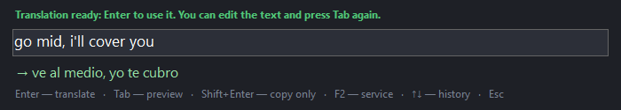
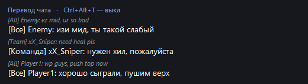
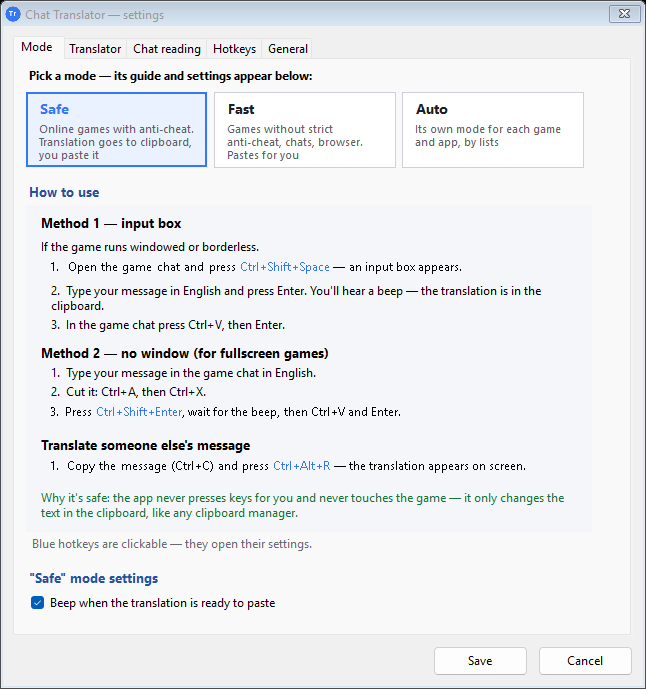
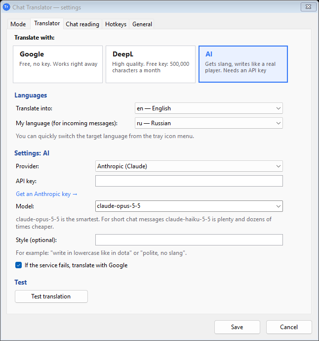

# Game Chat Translator

**English** · [Русский](README.ru.md)

A tiny Windows tray app that translates **your** chat messages for online games and messengers.
Type in your own language, press a hotkey, and the translation is ready to paste, or the app pastes it into the chat for you.

- **Light:** one ~140 KB `.exe`, ~35 MB RAM, nothing to install (uses the .NET Framework built into Windows).
- **Anti-cheat friendly "Safe" mode:** no simulated keystrokes and no access to the game process. The app only updates the clipboard.
- **Translators:** Google (free, no key), DeepL (free API key), or **AI** (Claude, or any OpenAI-compatible API) that understands gamer slang.
- **Per-game modes:** "Auto" mode picks safe or fast behaviour depending on which game or app you're in.
- **Reads incoming chat:** select the game's chat area once, and new messages are recognized (Windows built-in OCR, locally) and translated in a small click-through panel.
- **Both directions:** or just copy someone's message and press a hotkey to read it in your language.
- Interface in English and Russian.

<p align="center">
  <br>
  <br>
  
  
</p>

## Download

Grab `ChatTranslator.exe` from the [latest release](https://github.com/GoGameGod/game-chat-translator/releases/latest) and run it.
The tray icon **Tr** appears next to the clock, and the settings open on first launch.

> The exe isn't code-signed, so Windows SmartScreen may say *"Windows protected your PC"*. Click **More info → Run anyway**.
> The release exe is built by GitHub Actions from this source code ([workflow](.github/workflows/build.yml)), and you can also [build it yourself](#build-from-source).

## How it works

| Hotkey (default) | Action |
|---|---|
| `Ctrl+Shift+Space` | **Input box** over the game: type your message → `Enter` (`Tab` previews the translation first) |
| `Ctrl+Shift+Enter` | **Translate the chat field**: type right in the game chat and press this instead of Enter |
| `Ctrl+Alt+R` | **Translate an incoming message**: copy it (`Ctrl+C`) and press, and the translation pops up on screen |
| `Ctrl+Alt+T` | **Read the game chat** on/off: new messages are translated automatically |

All hotkeys can be changed. Click the tray icon to turn the app on or off.

### Reading incoming chat

1. Switch the game to **borderless windowed** (Windows can't capture a game in exclusive fullscreen).
2. Press `Ctrl+Alt+T` in the game. The first time, the screen dims: drag over the area where chat messages appear.
3. A semi-transparent panel above the chat shows translations of **new** messages. Press `Ctrl+Alt+T` again to turn it off.

How it works: every 2 seconds (configurable) the app takes a picture of just that screen area. If it changed, the picture goes through **Windows' built-in OCR** (`Windows.Media.Ocr`, runs locally), lines it has already seen are skipped, and only new lines are sent to your translator in one request.
Messages already in your language aren't translated. The panel lets mouse clicks pass through and never takes focus.

For good recognition the OCR language should match the language other players write in. By default the app picks it from "Translate into". You can add OCR languages in *Windows Settings → Time & language → Language & region*.

### Modes

| Mode | What happens | For |
|---|---|---|
| **Safe** | The translation goes to the clipboard and you paste it yourself (`Ctrl+V`). The app never presses keys for you. | Online games with anti-cheat |
| **Fast** | The app pastes the translation into the chat for you (and can press Enter). | Games without strict anti-cheat, Discord, browser |
| **Auto** | Each game or app gets its own mode from two lists. Add the current game from the tray menu in two clicks. | Mixed use |

Each mode has a step-by-step guide right in the settings, and the hotkeys in it are links to their settings.

**Fullscreen games:** if a game minimizes when the input box appears, switch the game to *borderless windowed*, or use `Ctrl+Shift+Enter`, which needs no window.

### About anti-cheat

In **Safe** mode the app does nothing a clipboard manager or Discord doesn't already do:
- hotkeys use the standard Windows `RegisterHotKey` API (no keyboard hooks);
- no simulated input and no reading or writing of game memory;
- to tell which game is active, it reads the process name from the system process list without opening the game process;
- chat reading only captures the selected screen area, the same way OBS or Discord screen sharing does.

**Fast** mode simulates `Ctrl+A / Ctrl+C / Ctrl+V / Enter` like a regular keyboard. Strict anti-cheats may treat that as a macro.
Nobody can guarantee how a closed-source anti-cheat behaves, so use this app at your own risk.

## Translators

| Service | Key | Notes |
|---|---|---|
| Google | not needed | Free web access; slang is sometimes translated literally |
| DeepL | [free API key](https://www.deepl.com/pro-api) (500,000 chars/month) | Great quality for common languages |
| Claude | [Anthropic API key](https://console.anthropic.com/settings/keys) | Understands slang and tone. `claude-haiku-5-5` is plenty for chat and very cheap |
| OpenAI-compatible | depends on service | OpenAI, OpenRouter, DeepSeek, Groq, or local LM Studio / Ollama (no key) |

If DeepL or the AI fails, the app can fall back to Google.

## Privacy

- Message text is sent only to the translation service you choose.
- Screen pictures for chat reading never leave your PC: text recognition is done locally by Windows, and only the recognized new lines go to the translator.
- API keys are stored encrypted with Windows DPAPI in `%APPDATA%\ChatTranslator\settings.json`, so only your Windows account can read them.
- No telemetry. The only other network call is the "Check for updates" button (GitHub API).
- `log.txt` in the same folder contains only error messages, never your texts or keys.

## Build from source

Requirements: Windows 10/11. The C# compiler that comes with .NET Framework 4.x is enough. OCR uses the WinRT metadata in `C:\Windows\System32\WinMetadata`, so no Windows SDK is needed.

```bat
build.cmd
```

This produces `ChatTranslator.exe` in the repo root. Code layout:

```
src/Program.cs          entry point, single instance
src/Settings.cs         settings, languages, UI localization
src/Translator.cs       Google, DeepL, Claude, OpenAI-compatible
src/Ocr.cs              Windows OCR (WinRT) + screen capture
src/ChatReader.cs       incoming chat: capture → OCR → dedupe → translate
src/Native.cs           WinAPI: hotkeys, SendInput, clipboard, autostart, log
src/Help.cs             per-mode guides (RU/EN)
src/TrayApp.cs          tray logic, modes, hotkey handling
src/UI/*.cs             settings window, input box, toast, controls
tools/make-icon.ps1     regenerates assets/app.ico
```

Developer switches:
- `ChatTranslator.exe --render-docs <folder> [ru|en]` renders all windows to PNG (used for these screenshots);
- `ChatTranslator.exe --ocr-test <image.png> <out.txt> [ocr-lang]` runs OCR → dedupe → translation on an image file.

## Contributing

Bug reports and ideas are welcome in [Issues](https://github.com/GoGameGod/game-chat-translator/issues).

## License

[MIT](LICENSE)
