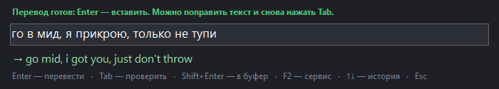
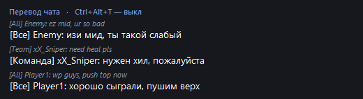
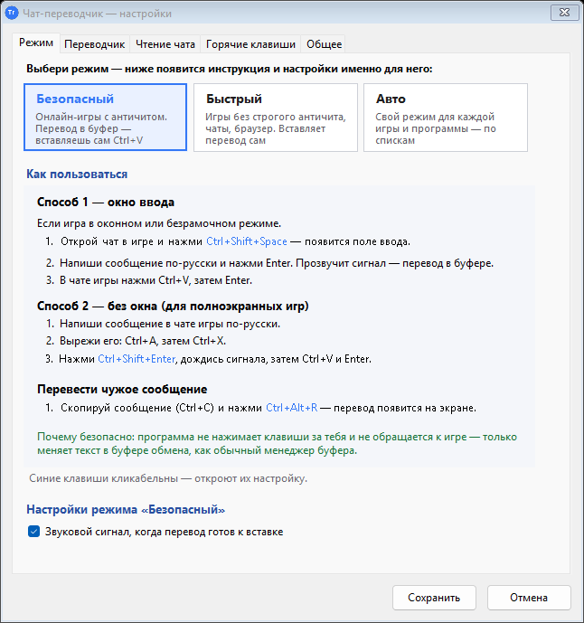
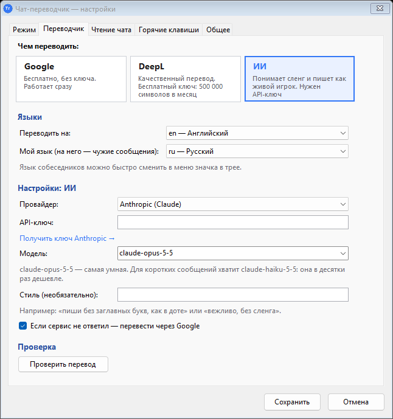

# Чат-переводчик для игр

[English](README.md) · **Русский**

Маленькая программа в трее Windows, которая переводит **твои** сообщения для чата в онлайн-играх и мессенджерах.
Пишешь на своём языке, жмёшь горячую клавишу, и перевод готов к вставке. Или программа сама вставит его в чат.

- **Лёгкая:** один `.exe` около 140 КБ, в фоне примерно 35 МБ памяти. Ничего ставить не нужно, всё нужное уже есть в Windows.
- **Безопасный режим для игр с античитом:** программа не нажимает клавиши за тебя и не обращается к процессу игры, а только меняет текст в буфере обмена.
- **Переводчики:** Google (бесплатно, без ключа), DeepL (бесплатный ключ) или **ИИ** (Claude или любой OpenAI-совместимый API), который понимает игровой сленг.
- **Режим под каждую игру:** в режиме «Авто» программа сама выбирает безопасный или быстрый вариант в зависимости от игры.
- **Читает входящий чат:** один раз выдели область чата игры, и новые сообщения будут распознаваться (встроенный OCR Windows, прямо на компьютере) и переводиться на маленькой панели, которая не мешает кликам.
- **В обе стороны:** или просто скопируй чужое сообщение, нажми клавишу и прочитай его на своём языке.
- Интерфейс на русском и английском.

<p align="center">
  <br>
  <br>
  
  
</p>

## Скачать

Скачай `ChatTranslator.exe` из [последнего релиза](https://github.com/GoGameGod/game-chat-translator/releases/latest) и запусти.
Возле часов появится значок **Tr**, а при первом запуске откроются настройки.

> У exe нет цифровой подписи, поэтому Windows SmartScreen может показать *«Система Windows защитила ваш компьютер»*.
> Нажми **Подробнее → Выполнить в любом случае**. Exe в релизах собирает GitHub Actions из этого исходного кода ([workflow](.github/workflows/build.yml)).
> Можно [собрать и самому](#сборка-из-исходников).

## Как пользоваться

| Клавиши (по умолчанию) | Что делает |
|---|---|
| `Ctrl+Shift+Space` | **Окно ввода** поверх игры: пишешь сообщение → `Enter` (`Tab` сначала покажет перевод) |
| `Ctrl+Shift+Enter` | **Перевести текст из чата**: пишешь прямо в чате игры и жмёшь это вместо Enter |
| `Ctrl+Alt+R` | **Перевести чужое сообщение**: скопируй (`Ctrl+C`) и нажми, перевод появится на экране |
| `Ctrl+Alt+T` | **Читать чат игры** вкл/выкл: новые сообщения переводятся сами |

Все сочетания можно поменять. Клик по значку в трее включает и выключает программу.

### Чтение входящего чата

1. Переключи игру в режим **«оконный без рамки»** (borderless): в эксклюзивном полноэкранном режиме Windows не может снять картинку игры.
2. В игре нажми `Ctrl+Alt+T`. В первый раз экран затемнится: выдели мышкой область, где идут сообщения чата.
3. Над чатом появится полупрозрачная панель с переводом **новых** сообщений. Выключить — снова `Ctrl+Alt+T`.

Как это работает: раз в 2 секунды (настраивается) программа снимает картинку только этой области экрана. Если картинка изменилась, текст распознаёт **встроенный OCR Windows** (`Windows.Media.Ocr`, прямо на компьютере). Уже виденные строки отсеиваются, и в переводчик одним запросом уходят только новые.
Сообщения на твоём языке не переводятся. Панель пропускает клики мышью и не забирает фокус.

Чтобы текст распознавался хорошо, язык распознавания должен совпадать с языком, на котором пишут собеседники. По умолчанию он берётся из настройки «Переводить на». Добавить языки распознавания можно в *Параметры Windows → Время и язык → Язык и регион*.

### Режимы

| Режим | Что происходит | Для чего |
|---|---|---|
| **Безопасный** | Перевод попадает в буфер, вставляешь сам (`Ctrl+V`). Программа не нажимает клавиши за тебя | Онлайн-игры с античитом |
| **Быстрый** | Программа сама вставляет перевод в чат (и может нажать Enter) | Игры без строгого античита, Discord, браузер |
| **Авто** | Для каждой игры и программы свой режим, по спискам. Текущую игру можно добавить в список из меню трея в два клика | Смешанное использование |

У каждого режима в настройках есть пошаговая инструкция, а горячие клавиши в ней работают как ссылки на свои настройки.

**Полноэкранные игры:** если игра сворачивается, когда появляется окно ввода, переключи её в «оконный без рамки» (borderless) или пользуйся `Ctrl+Shift+Enter`: этой клавише окно не нужно.

### Про античиты

В **безопасном** режиме программа делает не больше, чем менеджер буфера обмена или Discord:
- горячие клавиши работают через штатный `RegisterHotKey` Windows, без перехвата клавиатуры;
- программа не эмулирует ввод и не читает и не пишет память игры;
- какая игра сейчас открыта, она узнаёт по имени процесса из общего списка Windows и сам процесс игры не открывает;
- чтение чата снимает только выбранную область экрана, так же как OBS или демонстрация экрана в Discord.

**Быстрый** режим нажимает `Ctrl+A / Ctrl+C / Ctrl+V / Enter` как обычная клавиатура, и строгий античит может принять это за макрос.
Поведение закрытых античитов никто гарантировать не может: используй программу на свой риск.

## Переводчики

| Сервис | Ключ | Особенности |
|---|---|---|
| Google | не нужен | Бесплатный веб-доступ, сленг иногда переводит дословно |
| DeepL | [бесплатный API-ключ](https://www.deepl.com/pro-api) (500 000 символов в месяц) | Высокое качество для популярных языков |
| Claude | [API-ключ Anthropic](https://console.anthropic.com/settings/keys) | Понимает сленг и тон. Для чата хватит `claude-haiku-5-5`, она очень дешёвая |
| OpenAI-совместимые | зависит от сервиса | OpenAI, OpenRouter, DeepSeek, Groq, а также локальные LM Studio и Ollama (без ключа) |

Если DeepL или ИИ не ответил, программа может перевести через Google.

## Приватность

- Текст сообщений уходит только в выбранный сервис перевода.
- Картинки экрана для чтения чата не покидают компьютер: текст распознаёт сама Windows, а в переводчик уходят только новые распознанные строки.
- Ключи хранятся в `%APPDATA%\ChatTranslator\settings.json` зашифрованными (Windows DPAPI): прочитать их может только твоя учётная запись Windows.
- Телеметрии нет. Кроме переводчика, программа обращается в сеть только по кнопке «Проверить обновления» (GitHub API).
- В `log.txt` в той же папке пишутся только ошибки, без твоих текстов и ключей.

## Сборка из исходников

Нужна Windows 10/11. Компилятора C#, который входит в .NET Framework 4.x, достаточно. Для OCR используются метаданные WinRT из `C:\Windows\System32\WinMetadata`, поэтому Windows SDK не нужен.

```bat
build.cmd
```

Служебные ключи:
- `ChatTranslator.exe --render-docs <папка> [ru|en]` сохраняет все окна в PNG (так сделаны скриншоты выше);
- `ChatTranslator.exe --ocr-test <картинка.png> <out.txt> [язык_OCR]` прогоняет картинку через распознавание, отсев повторов и перевод.

## Идеи и ошибки

Пиши в [Issues](https://github.com/GoGameGod/game-chat-translator/issues).

## Лицензия

[MIT](LICENSE)
